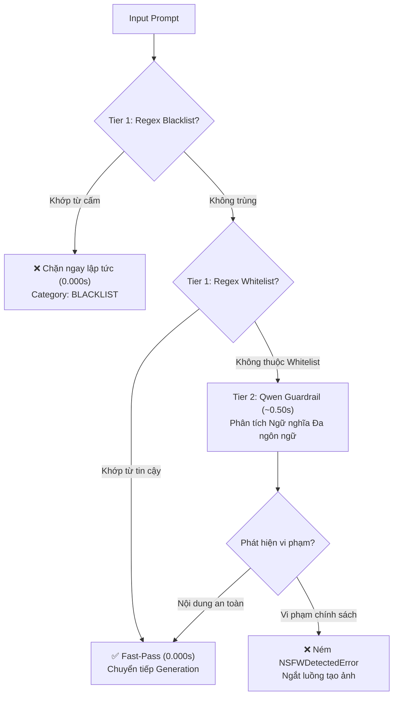

# ComfyUI-Detect-NSFW-Text 🛡️

[](https://github.com/comfyanonymous/ComfyUI)
[](https://huggingface.co/Qwen)
[](#key-features)
[](#key-features)
[](LICENSE)

> **High-Speed, Multilingual AI Content Moderation Node for ComfyUI powered by Qwen Guardrail.**

**ComfyUI-Detect-NSFW-Text** là node kiểm duyệt nội dung văn bản (Prompt Moderation) thế hệ mới dành cho ComfyUI. Được xây dựng trên kiến trúc **phòng thủ 2 lớp (Hybrid 2-Tier)** kết hợp mô hình ngôn ngữ **Qwen Guardrail**, node đem lại khả năng kiểm duyệt chính xác tuyệt đối, tốc độ siêu tốc và hỗ trợ đa ngôn ngữ không rào cản.

---

## ⚡ Tính Năng Nổi Bật (Key Features)

- ⚡ **Turbo Speed (~0.55s/prompt):** Tối ưu hóa token output và cơ chế caching `CLIPLoader`, xử lý cực nhanh, **tiết kiệm hơn 27% thời gian** so với các giải pháp thông thường.
- 🛡️ **Hybrid 2-Tier Defense:**
  - **Tier 1 (Fast-Pass / Fast-Block — 0.000s):** Lọc regex tức thì cho Blacklist & Whitelist, **0% tải GPU**, chặn hoặc thông qua ngay lập tức.
  - **Tier 2 (Multilingual Semantic Guardrail — ~0.50s):** Phân tích ngữ nghĩa chuyên sâu bằng mô hình Qwen3 đa ngôn ngữ cho các trường hợp phức tạp.
- 🌐 **Multilingual Semantic Blacklist:** Chỉ cần nhập từ khóa tiếng Anh vào `blacklist.txt` (ví dụ: *breastfeeding*, *nude statue*, *bikini*), mô hình tự động hiểu ngữ nghĩa và chặn tất cả biến thể tương đương bằng **tiếng Việt, tiếng Nhật, tiếng Thái, tiếng Trung...** với category `BLACKLIST`!
- 🔒 **6 Danh Mục Kiểm Duyệt Toàn Diện:** Bao phủ chặt chẽ mọi rủi ro an toàn: `NSFW`, `GORE_VIOLENCE`, `WEAPONS_EXPLOSIVES`, `CHILD_ABUSE`, `ANIMAL_ABUSE`, và `BLACKLIST`.
- 🔄 **Realtime Hot-Reload:** Thêm/sửa từ khóa trong `blacklist.txt` hoặc `whitelist.txt` có **hiệu lực tức thì mà KHÔNG CẦN restart ComfyUI** (nhờ cơ chế `IS_CHANGED` tracking hash và mtime).
- 🛡️ **Fail-Closed Security & Anti-Bypass:** Ràng buộc schema JSON nghiêm ngặt, chống duplicate keys, vô hiệu hóa jailbreak prompt (`/no_think`), tự động **Fail-Closed** (chặn an toàn) nếu phát hiện bất kỳ phản hồi bất thường nào.

---

## 🏗️ Kiến Trúc Phòng Thủ 2 Lớp (2-Tier Architecture)



---

## 🔒 6 Danh Mục Vi Phạm (Policy Categories)

| Danh Mục | Phạm Vi Nhận Diện & Kiểm Duyệt |
| :--- | :--- |
| **`NSFW`** | Nội dung khiêu dâm, tình dục rõ ràng, khỏa thân dung tục, gạ gẫm tình dục. |
| **`GORE_VIOLENCE`** | Bạo lực cực đoan, máu me ghê rợn, cắt xẻ cơ thể, tra tấn dã man, tự hại. |
| **`WEAPONS_EXPLOSIVES`** | Hướng dẫn chế tạo, sửa đổi hoặc sử dụng vũ khí tự chế, súng đạn, chất nổ, bom ống. |
| **`CHILD_ABUSE`** | Lạm dụng, bóc lột tình dục hoặc gây tổn hại đến thể xác/tinh thần trẻ vị thành niên. |
| **`ANIMAL_ABUSE`** | Hành vi tàn ác, tra tấn, kích động chọi chó/đá gà hoặc cố ý sát hại động vật. |
| **`BLACKLIST`** | Khái niệm/chủ đề trong danh sách cấm, nhận diện ngữ nghĩa đa ngôn ngữ (Semantic Cross-Lingual). |

---

## 🚀 Cài Đặt & Khởi Động Nhanh (Quick Start)

### Bước 1: Cài đặt Custom Node
Mở terminal và di chuyển vào thư mục `ComfyUI/custom_nodes/`:
```bash
cd ComfyUI/custom_nodes
git clone https://github.com/comfyanonymous/comfyUI-detect-nsfw-text.git
cd comfyUI-detect-nsfw-text
pip install -r requirements.txt
```

### Bước 2: Tải mô hình Qwen Text Encoder
Tải mô hình Guardrail (khuyên dùng `qwen3vl_8b_int8_convrot.safetensors`) và đặt vào:
```
ComfyUI/models/clip/
# hoặc
ComfyUI/models/text_encoders/
```

### Bước 3: Thêm Node vào Workflow
1. Mở giao diện ComfyUI, nhấp chuột phải: **safety** ➔ **Detect NSFW Text**.
2. Nối dây đầu vào `prompt` từ Text Primitive hoặc Prompt Box.
3. Nối đầu ra `prompt` an toàn sang node `CLIPTextEncode` (hoặc KSampler).
4. *(Tùy chọn)* Nối model CLIP từ node `CLIPLoader` để tái sử dụng VRAM (0.00s load time).

---

## 🔌 Đặc Tả Cổng I/O (Inputs & Outputs)

### Inputs
| Tên Cổng | Kiểu Dữ Liệu | Bắt Buộc | Mô Tả |
| :--- | :---: | :---: | :--- |
| **`prompt`** | `STRING` | Có | Chuỗi prompt người dùng cần kiểm duyệt (hỗ trợ multiline). |
| **`clip_name`** | `STRING` | Có | Tên file model CLIP (Mặc định: `qwen3vl_8b_int8_convrot.safetensors`). |
| **`language_filter`** | `COMBO` | Có | `all_languages` (mặc định đa ngôn ngữ) hoặc `english_only` (chỉ tiếng Anh). |
| **`clip`** | `CLIP` | Không | Kết nối từ node `CLIPLoader` để dùng chung cache mô hình. |
| **`blacklist`** | `STRING` | Không | Danh sách từ khóa cấm bổ sung trực tiếp trên giao diện widget. |
| **`whitelist`** | `STRING` | Không | Danh sách từ khóa tin cậy để Fast-Pass bỏ qua kiểm duyệt GPU. |

### Outputs
| Tên Cổng | Kiểu Dữ Liệu | Mô Tả |
| :--- | :---: | :--- |
| **`prompt`** | `STRING` | Chuỗi prompt gốc được chuyển tiếp an toàn nếu không vi phạm. |
| **`report`** | `STRING` | Báo cáo chi tiết định dạng JSON (`blocked`, `categories`, `reason`). |

> [!IMPORTANT]
> **Cơ Chế Ngắt Luồng Tức Thì:** Khi phát hiện vi phạm chính sách, node sẽ chủ động ném ngoại lệ `NSFWDetectedError`. Quá trình sinh ảnh phía sau lập tức bị chặn đứng để bảo vệ hệ thống và tiết kiệm tài nguyên GPU.

---

## 📋 Mẫu Báo Cáo JSON (Audit Report Example)

### Khi nội dung an toàn (Passed):
```json
{
  "blocked": false,
  "categories": [],
  "reason": null
}
```

### Khi vi phạm chính sách an toàn (Blocked):
```json
{
  "blocked": true,
  "categories": ["WEAPONS_EXPLOSIVES"],
  "reason": "Violation: ['WEAPONS_EXPLOSIVES']"
}
```

### Khi kích hoạt Semantic Blacklist:
```json
{
  "blocked": true,
  "categories": ["BLACKLIST"],
  "reason": "Violation: ['BLACKLIST']"
}
```

---

## 🔄 Cấu Hình Hot-Reload (Blacklist & Whitelist)

Node hỗ trợ 2 file cấu hình nằm ngay trong thư mục node:
- **`blacklist.txt`:** Chứa từ khóa/khái niệm cấm. Mỗi dòng 1 từ khóa (ví dụ: `bikini`, `breastfeeding`, `nude statue`).
- **`whitelist.txt`:** Chứa từ khóa tin cậy cho phép đi qua ngay lập tức.

💡 **Không cần khởi động lại ComfyUI:** Bạn có thể chỉnh sửa `blacklist.txt` / `whitelist.txt` bất kỳ lúc nào; lần chạy tiếp theo ComfyUI sẽ tự động nhận diện thay đổi ngay lập tức!

---

## 🎨 Workflow Mẫu (Example Workflow)

Repo đi kèm sẵn file cấu hình workflow hoàn chỉnh:
- [workflow_nsfw_detect_example.json](workflow_nsfw_detect_example.json)

Kéo thả trực tiếp file JSON trên vào giao diện web ComfyUI để trải nghiệm ngay quy trình kết nối chuẩn từ `CLIPLoader` ➔ `Detect NSFW Text` ➔ `PreviewAny`.

---

## 📄 Bản Quyền (License)

Dự án được phân phối dưới giấy phép mã nguồn mở **MIT License**. Mọi đóng góp (Pull Request, Bug Report) đều được hoan nghênh!
